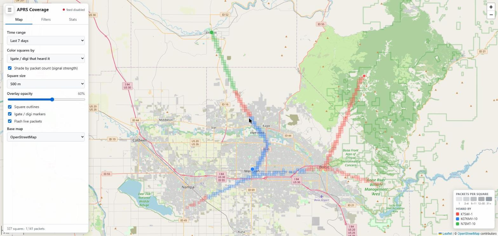

# APRS Coverage

A public map of real APRS RF coverage in SW Idaho, built from the packets of a
short list of registered mobile stations.

Live site: https://apps.k7swi.org

When a registered mobile's position packet reaches APRS-IS over RF, the small
square it was sent from is marked as covered. Over time, drives fill in a map of
where the local igates and digipeaters can actually hear a mobile.



*Screenshot uses synthetic demo data.*

## Features

- **Read-only APRS-IS feed.** Logs in with passcode `-1`, so nothing is ever sent.
  It filters for the registered stations only and ignores all other traffic.
- **RF only.** Packets that entered APRS-IS over the internet (`qAC`, APRSdroid over
  TCP, and so on) are dropped, because they say nothing about RF coverage.
- **Credit goes to the station that heard the mobile.** If a packet went through a
  digipeater, the square is credited to the first digi that heard it, not the igate
  that gated it.
- **Data-quality filters.** Drops ambiguous and 0,0 positions, duplicates, impossible
  speed jumps, and (optionally) anything outside a set region. Rejects are listed
  on the admin page with the reason.
- **History.** Every accepted packet is stored in SQLite, so coverage can be viewed
  for any time range, not just what APRS-IS still holds.
- **Map.**
  - OpenStreetMap, OpenTopoMap, USGS Topo and USGS Imagery basemaps
  - Square size from 100 m to 2 km, adjustable overlay opacity
  - Color squares by igate/digi, by reporting mobile, or one color for overall coverage
  - Shade squares by packet count as a rough measure of signal strength
  - Filter by mobile and by igate/digi
  - Time presets (24 hours to all time) or a custom range
  - Live updates: new packets appear and flash as they arrive
  - Stats per igate/digi (squares, farthest distance, packets gated) and per mobile
- **Admin page** (`/admin`, one password-protected account). Register mobiles, igates
  and digipeaters, and see the APRS-IS connection status and recent rejects.
  Station changes take effect immediately, without a restart.

See [docs/PLAN.md](docs/PLAN.md) for the design, attribution rules and known limitations.

## How it works

```
APRS-IS (read-only) -> ingester -> SQLite -> FastAPI -> nginx -> Leaflet map
```

It is one Python process (FastAPI + uvicorn, with the APRS-IS reader running as a
background task) and one SQLite file. Grid squares are computed when the map asks
for them, so the square size can be changed at any time without reprocessing data.

| Path | What it is |
|---|---|
| `app/ingest.py` | APRS-IS client and live-update broadcast |
| `app/packets.py` | Packet parsing, route attribution and quality checks (no I/O) |
| `app/grid.py` | Square grid math |
| `app/main.py` | Public API, live feed (SSE) and admin API |
| `app/manage.py` | Command-line password reset |
| `static/` | Map and admin pages (plain JS + Leaflet, no build step) |
| `setup.sh`, `update.sh`, `auto-update.sh` | Server install, deploy and cron auto-update |

## Deploying

The scripts target a Debian or Ubuntu server (a Proxmox VM or LXC container works)
with nginx and systemd. The app installs to `/srv/aprs-coverage`, runs as `www-data`
on `127.0.0.1:8077`, and nginx serves it at `apps.k7swi.org`.

### Before you start

- DNS for `apps.k7swi.org` points at the server, and ports 80 and 443 reach it.
- `git` and `sudo` are installed. A fresh Debian LXC often has neither:
  `apt install git sudo`.
- Nothing else on the server uses port 8077. If something does, change `PORT` in
  `setup.sh` and the two `proxy_pass` lines in `nginx-aprs-coverage.conf`.
- No other nginx site already uses `server_name apps.k7swi.org`. If one does, nginx
  warns about a conflicting server name and only one of them will answer.

### First install

```bash
# 1. Get the code. Keep this checkout; updates are pulled into it.
sudo git clone https://github.com/jeepnjonny/aprs-coverage.git /opt/aprs-coverage-src
cd /opt/aprs-coverage-src

# 2. Install packages, the systemd service and nginx, get a certificate, and set
#    the admin password (you will be prompted for it and for a Let's Encrypt email).
sudo bash setup.sh --ssl

# 3. Set the APRS-IS login name. Use your callsign with an SSID no other station
#    uses, for example K7SWI-CV. It is read-only, so no passcode is needed.
sudo nano /srv/aprs-coverage/.env
sudo systemctl restart aprs-coverage
```

Then open `https://apps.k7swi.org/admin`, log in, and register your stations:

- **Mobiles**: an exact callsign-SSID (`K7ABC-9`), or `K7ABC*` to match every SSID.
  Only mobiles create coverage.
- **Igates / digipeaters**: their exact callsign-SSID. Give each one a position, or
  leave it blank and the map uses the position the station beacons.

The admin page shows the APRS-IS connection state. Coverage appears as soon as a
registered mobile is heard on RF.

Running `setup.sh` without `--ssl` sets up plain HTTP only. Admin login needs HTTPS
unless `COOKIE_SECURE=0` is set in `.env`.

### Updating

Manually:

```bash
cd /opt/aprs-coverage-src
sudo git pull
sudo bash update.sh
```

`update.sh` copies the code to `/srv/aprs-coverage`, updates Python packages and
restarts the service. It never touches `.env` or the database in `/srv/aprs-coverage/data`.

Automatically: `auto-update.sh` checks GitHub and deploys only when there are new
commits. Add it to root's crontab (`sudo crontab -e`) to check every 10 minutes:

```cron
*/10 * * * * /usr/bin/flock -n /tmp/aprs-coverage-update.lock bash /opt/aprs-coverage-src/auto-update.sh >> /var/log/aprs-coverage-update.log 2>&1
```

It refuses to run if the checkout has local edits, so edit `.env` in
`/srv/aprs-coverage`, not in the checkout.

### Running it

```bash
sudo systemctl status aprs-coverage          # is it running?
sudo journalctl -u aprs-coverage -f          # logs, including APRS-IS connects and filter changes
cd /srv/aprs-coverage && sudo -u www-data .venv/bin/python -m app.manage set-password   # reset admin password
cd /srv/aprs-coverage && sudo -u www-data .venv/bin/python -m app.manage logout-all     # end all admin sessions
```

### Configuration

Settings live in `/srv/aprs-coverage/.env`. See [.env.example](.env.example) for the
full list. Restart the service after changing them.

| Setting | Default | Meaning |
|---|---|---|
| `APRS_LOGIN` | (none) | APRS-IS login name, e.g. `K7SWI-CV`. Required. |
| `APRS_SERVER` / `APRS_PORT` | `rotate.aprs2.net` / `14580` | APRS-IS server |
| `APRS_ENABLED` | `1` | `0` turns the feed off (map still works) |
| `DB_PATH` | `/srv/aprs-coverage/data/coverage.sqlite` | Database file |
| `GRID_REF_LAT` | `43.6` | Latitude that sets square width. Pick once; changing it moves every square. |
| `MAX_SPEED_KMH` | `250` | Faster jumps between fixes are rejected |
| `DUPLICATE_WINDOW_S` | `30` | Same-position repeats within this window are rejected |
| `REGION_BBOX` | (off) | `min_lat,min_lon,max_lat,max_lon`; positions outside are rejected |
| `COOKIE_SECURE` | `1` | `0` only for local testing over plain HTTP |
| `SESSION_DAYS` | `30` | Admin login lifetime |

## Local development

Windows (PowerShell):

```powershell
python -m venv .venv
.venv\Scripts\pip install -r requirements-dev.txt
.venv\Scripts\python -m pytest -q
$env:COOKIE_SECURE="0"; $env:APRS_LOGIN="N0CALL-CV"
.venv\Scripts\python -m app.manage set-password
.venv\Scripts\python -m uvicorn app.main:app --port 8077
```

Linux / macOS:

```bash
python3 -m venv .venv
.venv/bin/pip install -r requirements-dev.txt
.venv/bin/python -m pytest -q
export COOKIE_SECURE=0 APRS_LOGIN=N0CALL-CV
.venv/bin/python -m app.manage set-password
.venv/bin/python -m uvicorn app.main:app --port 8077
```

Then open http://localhost:8077. The database is created at `data/coverage.sqlite`.
Set `APRS_ENABLED=0` to work on the map without connecting to APRS-IS.
