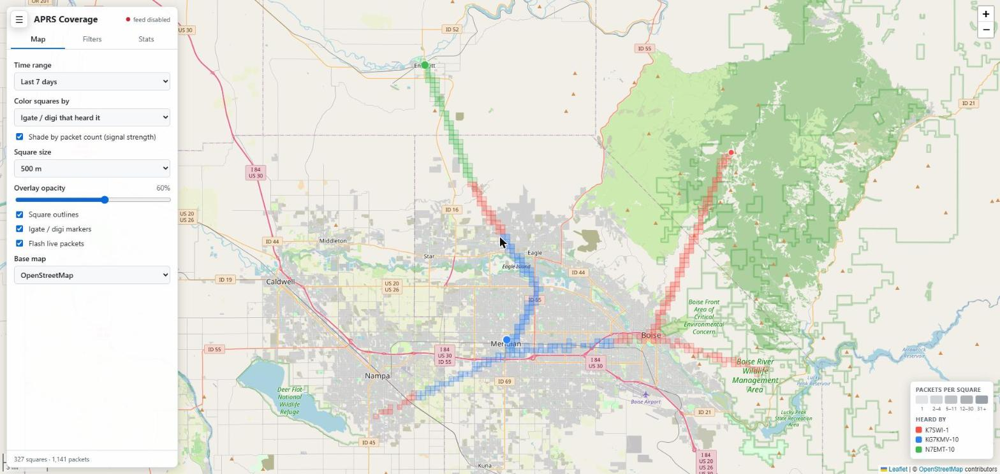

# APRS Coverage

A public map of real APRS RF coverage in SW Idaho, built from the packets of a
short list of registered mobile stations.

Live site: https://apps.k7swi.org/aprs-coverage/

When a registered mobile's position packet reaches APRS-IS over RF, the small
square it was sent from is marked as covered. Over time, drives fill in a map of
where the local igates and digipeaters can actually hear a mobile.



*Screenshot uses synthetic demo data.*

## Features

- **Read-only APRS-IS feed.** Logs in with passcode `-1`, so the coverage feed never sends anything.
  Only the admin Node config tab sends, on its own connection (below).
  It filters for the registered stations only and ignores all other traffic.
  Trackers that report as APRS objects are registered as `SENDER:OBJECT` (`K7SWI:CAR01`).
- **RF only.** Packets that entered APRS-IS over the internet (`qAC`, APRSdroid over
  TCP, and so on) are dropped, because they say nothing about RF coverage.
- **Credit goes to the station that heard the mobile.** If a packet went through a
  digipeater, the square is credited to the first digi that heard it, not the igate
  that gated it.
- **Data-quality filters.** Drops ambiguous and 0,0 positions, duplicates, impossible
  speed jumps, and (optionally) anything outside a set region. Rejects are listed
  on the admin page with the reason and kept for 2 days.
- **Every station that heard a packet** (optional). APRS-IS passes on only the first copy
  of a packet. If your igates connect to your own aprsc, the app can also read its
  duplicates feed, so a packet heard by three igates credits all three. Set up on the
  admin page; see [Duplicates feed](#duplicates-feed-your-own-aprsc).
- **History.** Every accepted packet is stored in SQLite, so coverage can be viewed
  for any time range, not just what APRS-IS still holds.
- **Map.**
  - OpenStreetMap, OpenTopoMap, USGS Topo and USGS Imagery basemaps
  - Square size from 100 m to 2 km, adjustable overlay opacity
  - Color squares by igate/digi, by reporting mobile, or one color for overall coverage
  - **Reliability view** (Color squares by → Reliability): each square colored by the share of
    beacons sent from it that reached APRS-IS, red (under 25%) through gray to blue (90%+).
    Red squares were driven but rarely heard; blank means nobody drove there. Exact where a
    tracker uploads its transmit log; for other trackers, lost beacons are estimated from gaps
    between packets heard, using each tracker's beaconing (smart beaconing or a fixed rate)
    worked out automatically from its own packets, and placed along the line between the two
    fixes. Gaps while parked count only for trackers seen beaconing steadily while parked. Squares with few beacons are drawn fainter. The igate/digi filter
    applies: pick one station to see what it alone would cover. `GET /api/reliability`.
  - Shade squares by packet count. This mostly shows how much time was spent in a square, not
    signal quality; use the reliability view for that
  - Outline squares with lost beacons (option): a red frame where a tracker that uploads its
    transmit log sent beacons that never reached APRS-IS, thicker and stronger with more lost.
    It sits on top of the reception colour without changing it. Red is reserved for this: no
    igate, digi or mobile can be given a red colour, and the automatic colours skip red.
  - Filter by mobile, by igate/digi, and by device hardware (Heltec T114, LoRanger V2, …), applied to
    mobiles, igates/digis or both
  - Time presets (15 minutes to 12 months, or all time) or a custom range whose end can be "now"
  - Live updates: new packets appear and flash as they arrive
  - "Show my location" puts a dot at your phone or computer's own position (browser
    geolocation, never sent to the server), with an option to keep the map centered on it
  - Stats per igate/digi (squares, farthest distance, packets gated) and per mobile
- **Compare two stations** (`/aprs-coverage/compare`, linked from the Stats tab). Two mobiles, or
  two igates/digis, side by side over weeks or months: share of transmissions heard per day, week
  or month with 95% confidence bands, a plain-language verdict with a significance test, reach by
  distance for igates/digis, and dated device notes (antenna swap, move) drawn on the chart. See
  [Comparisons](#comparisons).
- **Device log uploads** (optional). An app connected to a tracker can upload what it sent and heard
  with an API key from the account page, or the tracker's owner can upload its transmit log copied off
  its SD card, which makes mobile comparisons exact instead of estimated. Nothing else depends on it. See [Device log uploads](#device-log-uploads).
- **Accounts** (`/aprs-coverage/admin`, linked from the map as *Join / Log in*). Anyone who runs
  an igate, digi or tracker can sign up with their callsign and the devices they run. The account
  and its devices stay pending, off the map and out of the APRS-IS filter, until an admin approves
  them. An approved node owner manages only their own devices (label, color, position, active,
  delete, add more for approval); a device's callsign and type are fixed once approved. Each device can
  record its hardware, picked from the boards the LoRa FieldOps firmware supports (or *Other*), and that
  can change at any time. Two roles:
  **admin** and **node owner**.
- **Admin pages.** Approve or reject sign-ups and new devices (with a reason the owner sees), manage
  users (role, disable, password reset, remote-config access), register stations directly and
  assign them to an owner, set the APRS-IS servers for the coverage and duplicates feeds, and see
  the connection status of both feeds and recent rejects. Station and feed changes take effect
  immediately, without a restart.
- **Node config tab** (admins, and node owners an admin has ticked "remote config" for, on their
  own nodes only, sending from their own callsign with any SSID). Reads and changes settings on registered
  [LoRa FieldOps](https://github.com/KJ7NYE/LoRa_FieldOps_APRS_Tracker) igates and digis over APRS
  messages (role, tactical callsign, symbol, beacon path, digi mode, beacon rate, GPS source,
  fixed position), using the firmware's CSR/CSU/CSW remote-config protocol, the same one
  CourseSentry uses. Commands are sent from the operator's own callsign, typed on the tab and
  remembered only in that browser; the app calculates its APRS-IS passcode and opens a
  separate, short-lived connection to send. Needs remote config turned on at the node
  (`remotecfg on`) and the node's unlock token for writes. Tokens are never stored or logged.
- **Logs tab** (admin). Live viewer for the APRS-IS traffic (the coverage feed and node-config
  connection line by line, plus duplicates-feed lines from registered stations, each with what
  the ingester did with it), the app's own log, and the accepted
  packet, rejected packet and node-config logs, and device log uploads. Live search with highlighting (plain text or
  regex), type filter, pause, auto-scroll, wrap, UTC/local time, clear and download.

See [docs/PLAN.md](docs/PLAN.md) for the design, attribution rules and known limitations.

## How it works

```
APRS-IS (read-only) ----------\
                               > ingester -> SQLite -> FastAPI -> nginx -> Leaflet map
aprsc duplicates feed (opt.) --/
```

It is one Python process (FastAPI + uvicorn, with the APRS-IS readers running as
background tasks) and one SQLite file. Grid squares are computed when the map asks
for them, so the square size can be changed at any time without reprocessing data.

| Path | What it is |
|---|---|
| `app/ingest.py` | APRS-IS clients (coverage and duplicates feeds) and live-update broadcast |
| `app/packets.py` | Packet parsing, route attribution and quality checks (no I/O) |
| `app/grid.py` | Square grid math |
| `app/remotecfg.py` | Remote node config: CSR/CSU/CSW messages, retries, replies |
| `app/logbuf.py` | In-memory APRS-IS traffic and app logs for the admin Logs tab |
| `app/main.py` | Public API, live feed (SSE) and admin API |
| `app/auth.py` | Accounts, roles and sessions |
| `app/manage.py` | Command-line user admin (first admin, password reset, lockout recovery) |
| `static/` | Map and admin pages (plain JS + Leaflet, no build step) |
| `setup.sh`, `update.sh`, `auto-update.sh` | Server install, deploy and cron auto-update |

## Deploying

The scripts target a Debian or Ubuntu server (a Proxmox VM or LXC container works)
with nginx and systemd. The app installs to `/srv/aprs-coverage` and runs as
`www-data` on `127.0.0.1:8077`. nginx serves it as a directory of the existing
`apps.k7swi.org` site: **https://apps.k7swi.org/aprs-coverage/**.

The repo's [nginx-aprs-coverage.conf](nginx-aprs-coverage.conf) is not a whole site.
It is a few `location /aprs-coverage/ ...` blocks that get included in the
`apps.k7swi.org` server block, which already has the HTTPS certificate. nginx strips
the `/aprs-coverage` prefix before passing requests to the app, and the pages use
relative URLs, so the app works under any path.

### Before you start

- `apps.k7swi.org` is already served by nginx over HTTPS on this server.
- `git` and `sudo` are installed. A fresh Debian LXC often has neither:
  `apt install git sudo`.
- Nothing else on the server uses port 8077. If something does, change `PORT` in
  `setup.sh` and the two `proxy_pass` lines in `nginx-aprs-coverage.conf`.
- Nothing else on `apps.k7swi.org` uses the `/aprs-coverage/` path.

### First install

```bash
# 1. Get the code. Keep this checkout; updates are pulled into it.
sudo git clone https://github.com/jeepnjonny/aprs-coverage.git /opt/aprs-coverage-src
cd /opt/aprs-coverage-src

# 2. Install packages and the systemd service, copy the nginx snippet to
#    /etc/nginx/snippets/aprs-coverage.conf, and set the admin password.
sudo bash setup.sh

# 3. Set the APRS-IS login name. Use your callsign with an SSID no other station
#    uses, for example K7ABC-CV. It is read-only, so no passcode is needed.
#    The feed stays off until this is set.
sudo nano /srv/aprs-coverage/.env
sudo systemctl restart aprs-coverage
```

4. Hook it into the site (one time only). `setup.sh` prints which file holds the
   `apps.k7swi.org` server block. Add this line inside the HTTPS (`listen 443`)
   server block, next to the other apps:

   ```nginx
   include snippets/aprs-coverage.conf;
   ```

   Then check and reload nginx:

   ```bash
   sudo nginx -t && sudo systemctl reload nginx
   ```

Then open https://apps.k7swi.org/aprs-coverage/admin, log in, and register your stations:

- **Mobiles**: an exact callsign-SSID (`K7ABC-9`), or `K7ABC*` to match every SSID.
  Only mobiles create coverage.
- **Igates / digipeaters**: their exact callsign-SSID. Give each one a position, or
  leave it blank and the map uses the position the station beacons.

The admin page shows the APRS-IS connection state. Coverage appears as soon as a
registered mobile is heard on RF. The admin login cookie is limited to
`/aprs-coverage/`, so it is never sent to the other apps on the site.

### Updating

Manually:

```bash
cd /opt/aprs-coverage-src
sudo git pull
sudo bash update.sh
```

`update.sh` copies the code to `/srv/aprs-coverage`, installs the pinned Python
packages and restarts the service. It then waits up to two minutes for the app to
answer. If it doesn't (or the package install fails), it puts the previous code
back from `/srv/aprs-coverage.prev`, restarts that, and exits with an error. If the
nginx snippet changed, it copies the new one to `/etc/nginx/snippets`, checks it
with `nginx -t`, and reloads nginx; if the check fails, it puts the old snippet
back. It never touches `.env` or the database in `/srv/aprs-coverage/data`.

Automatically: `auto-update.sh` checks GitHub and deploys when the branch has a
commit that isn't live yet. A deploy that fails is tried again on the next run, up
to three times for the same commit. Add it to root's crontab (`sudo crontab -e`)
to check every 10 minutes:

```cron
*/10 * * * * /usr/bin/flock -n /run/lock/aprs-coverage-update.lock bash /opt/aprs-coverage-src/auto-update.sh 2>&1 | systemd-cat -t aprs-coverage-update
```

Its output goes to the journal (`journalctl -t aprs-coverage-update`), which
rotates on its own. An older crontab line using `/tmp` and
`/var/log/aprs-coverage-update.log` keeps working, but that log file grows without
limit, so switching to the line above is worthwhile.

It refuses to run if the checkout has local edits, so edit `.env` in
`/srv/aprs-coverage`, not in the checkout.

### Running it

```bash
sudo systemctl status aprs-coverage          # is it running?
sudo journalctl -u aprs-coverage -f          # logs, including APRS-IS connects and filter changes
cd /srv/aprs-coverage && sudo -u www-data .venv/bin/python -m app.manage set-password [USER]  # set a password (default user: admin)
cd /srv/aprs-coverage && sudo -u www-data .venv/bin/python -m app.manage list-users           # users, roles, status
cd /srv/aprs-coverage && sudo -u www-data .venv/bin/python -m app.manage set-role USER admin  # make someone an admin
cd /srv/aprs-coverage && sudo -u www-data .venv/bin/python -m app.manage logout-all           # end every session
```

Upgrading from the single-password version turns that password into an admin
account named `admin` and logs everyone out once.

### Backups

The app copies its database once a day to `/srv/aprs-coverage/data/backups/`
(`coverage-YYYY-MM-DD.sqlite`) and keeps the newest three. Each copy is the full
size of the database. Set `BACKUP_KEEP` to keep more, or `0` to turn this off. The
copies are on the same disk, so also copy that folder somewhere else now and then.
To restore one, stop the service, copy it over `data/coverage.sqlite` (deleting
any `coverage.sqlite-wal` and `-shm` files next to it), and start the service.

### Duplicates feed (your own aprsc)

APRS-IS forwards only the first copy of each packet. When several igates gate the
same packet, the server drops the later copies (for about 30 s), so the map normally
credits only the igate or digi whose copy arrived first. To see every station that
heard a packet:

1. Run your own [aprsc](https://github.com/hessu/aprsc) server, uplinked to APRS-IS
   with a full feed, and add a duplicates listener to `aprsc.conf`, for example:

   ```
   Listen "Client-Defined Filters" igate    tcp ::0 14580
   Listen "Duplicates"             dupefeed tcp ::0 14501
   Uplink "Core rotate"            full     tcp noam.aprs2.net 10152
   ```

   Only the coverage app needs the duplicates port, so firewall it to that host (or
   listen on `127.0.0.1` if both run on the same machine). See the aprsc
   documentation for the server ID, passcode and uplink settings.
2. Point your igates at your aprsc (the APRS-IS server and port fields in the
   igate settings). aprsc forwards their packets to APRS-IS as usual.
3. On the admin page, under **Feed servers**:
   - Set the coverage feed to your aprsc's filtered port (14580), so both feeds
     come from the same server.
   - Tick **Connect to an aprsc duplicates feed** and enter the server, the
     duplicates port and a login. The login is read-only (passcode -1) and must
     differ from `APRS_LOGIN`, for example `K7SWI-DF`.
   - Save. Both feeds reconnect at once; no restart needed.

How copies are counted:

- Copies with the same source and the same packet content within
  `DUPLICATE_WINDOW_S` are one transmission, whichever path each copy took.
- Each copy is stored as its own row, credited to the station that heard it.
- Squares, mobile packet totals and per-station counts (heard direct, gated)
  count each transmission once. A packet heard by SQB and KJ7NYE-10 counts once
  in the square and once for each of the two stations.
- A copy with the same route as one already stored (for example, on both feeds)
  is rejected as a duplicate.
- The duplicates feed has no filter, so the app checks every line it sends and
  only logs lines from registered stations (tag `dupes` in the Logs tab).

What it can't show: each igate's firmware also drops duplicates. An igate that
hears a mobile directly and again through a digi gates only the first copy, so you
see what each igate gated, not everything it received.

### Comparisons

`/compare` puts two stations side by side. Everything works from APRS-IS data alone; uploads
only make mobile results exact.

**Two mobiles: share of transmissions that reached APRS-IS.**
- *Exact* where the mobile's transmit log was uploaded: each logged position beacon is matched
  to a stored packet (same information field, received 30 s before to 90 s after the logged
  time; closest pairs first, each stored packet used once, so a parked tracker repeating itself
  doesn't fool it). Unmatched beacons were lost.
- A logged beacon identical to a packet APRS-IS passed less than 30 s before it is not counted
  either way: APRS-IS drops such repeats as duplicates however well they were heard. A parked
  tracker beaconing faster than every 30 s repeats itself, so most of its beacons are left out.
- *Estimated* otherwise: from gaps between packets heard. Nothing to set: each tracker's
  beaconing is fitted from its own packets (`app/beacons.py`). Smart beaconing is modelled as
  fast rate, slow rate and distance between beacons in between, plus the share of extra beacons
  on turns (corner pegging); a fixed rate is the case where fast and slow rates are equal. A gap
  longer than the model predicts at the speed driven lost the beacons in between. Gaps while
  stopped count only for a tracker seen beaconing steadily while stopped, and then at most four
  in a row (more is switched off, not lost). In simulated drives with 10–70% loss the estimate
  lands within about 1–2 points of the true share on average.
- **Only when side by side** counts only packets sent while the two were within a set distance of
  each other (positions interpolated across gaps up to 5 minutes). Run both trackers in one
  vehicle with the same fixed rate, offset by half the interval so they don't collide, and this
  is a direct test of the devices.
- The verdict uses a two-proportion z-test. Also shown: share heard directly by an igate, stations
  per packet (needs the duplicates feed), and, from uploaded receive logs, how often and how
  strongly the mobile heard each digi repeat it.

**Two igates/digis: of the transmissions from registered mobiles that anyone heard, which each
heard.** *Counts as heard* is the first RF hop, or anywhere in the path. The verdict is a McNemar
test on the transmissions only one of them heard. This needs the
[duplicates feed](#duplicates-feed-your-own-aprsc); without it APRS-IS keeps only the first copy,
and the page says so. Sites see different traffic, so for a device test swap the two between
sites every week or two and add a note at each swap.

**One station, before and after a change.** Pick a station and a change (one of its device notes,
or a date) and a period either side (a week, two weeks, 30 days, or from the change until now). A
slopegraph shows the share heard before and after, with a significance test, a day-by-day chart
and the squares that got most better or worse. *Same route only* (on by default) counts only
squares driven in both periods, so a detour doesn't look like a change. For a mobile this is the
share of its beacons that got through (exact from transmit logs, else estimated); for an igate or
digi, the share of the transmissions anyone heard from those squares that it heard. Each device
note has a *Compare before and after* link. `GET /api/compare/change`, `GET /api/events?device=`.

**Device notes** are added on the compare page by a device's owner (or an admin), or uploaded by
the app as `event` entries.

### Device log uploads

Optional. On the account page (*Account* tab, *Upload keys*) an approved user makes a key; it is
shown once and stored hashed. An app sends:

```http
POST /aprs-coverage/api/devicelog
Authorization: Bearer acv_...
Content-Type: application/json

{
  "device": "K7ABC-9",
  "app": "lora-fieldops-config-android/1.5.0",
  "entries": [
    {"type": "tx", "ts": 1763251200, "packet": "K7ABC-9>APLRT1,WIDE1-1:!4336.66N/11612.40W>comment"},
    {"type": "rx", "ts": 1763251203, "packet": "K7ABC-9>APLRT1,SQB*,WIDE1*:!4336.66N/11612.40W>comment",
     "rssi": -97, "snr": 6.5},
    {"type": "event", "ts": 1763251300, "text": "beacon rate 60 s"}
  ]
}
```

- `device`: one of the key owner's approved devices (any device for an admin). A mobile registered
  as a pattern (`K7ABC-*`) uploads per SSID; an object tracker as `SENDER:OBJECT`. `tx` and `rx`
  are for mobiles; `event` for any device.
- `ts`: unix seconds when the line was logged (the phone's clock is fine), within the last 400 days.
- `tx`: a packet the device transmitted, as TNC2 text. A LoRa `<\xff\x01` prefix is stripped.
  Non-position packets are kept but not counted.
- `rx`: a packet it heard. Only its own packets repeated by a digi, and beacons from registered
  igates/digis, are kept; other traffic is counted as ignored and dropped. `rssi` (dBm) and
  `snr` (dB) are optional.
- Up to 1000 entries per request. Retries are safe: an entry already stored counts as a duplicate.
- Reply: `{"accepted": n, "duplicates": n, "ignored": n, "errors": [{"index": i, "error": "..."}],
  "tx": n, "heard": n}`: `tx` new position transmissions in this upload, `heard` how many of
  those already matched a packet on APRS-IS. 401 = bad key; 404 = not your device (the message
  lists the account's approved devices).
- The admin Logs tab has **Device uploads** (each upload and refusal with the reason, keys
  created and revoked, device notes, re-matching) and **Uploaded device log** (every stored
  line, whether each transmission was heard, and signal strength).

Logs uploaded before APRS-IS delivers the packets are matched again every 5 minutes for 2 days.

#### Transmit logs from a tracker's SD card

A tracker that keeps its own transmit log on an SD card (LoRanger V2) doesn't need an app or a key:
its owner (or an admin) uploads the file on the account page (*Account* tab, *Upload a tracker's
transmit logs*, or *Upload log* next to a mobile on *My devices*). Pick files, or the card's `log`
folder to send every session's `tx.csv` at once. Rows are stored and matched exactly like an app's
`tx` entries, so re-uploading the same card is harmless.

- Only transmit logs are taken. For coverage, what a tracker heard adds little; a receive log
  (a file with `rssi`/`snr` columns, like the V2's `rx.csv`) is refused. Apps can still send `rx`
  entries through the API above.
- CSV, up to 8 MB and 100,000 rows per file. The first row names the columns; it needs a time column
  (`utc`, `time`, `timestamp` or `ts`) and a packet column (`packet` or `raw`). With a `type` column,
  only `tx` rows are kept. Lines starting with `#` are ignored.
- Time: unix seconds or ISO 8601 (`2026-11-20T18:04:11Z`); a time without an offset is UTC. It must
  be real clock time (from GPS), not time since boot. Rows with an empty time (written before GPS had
  a fix) are skipped.
- Packet: the TNC2 line exactly as transmitted, quoted or, as the last column, unquoted with commas.
- Packets the tracker relayed for other stations are ignored. A file with none of the chosen
  device's own transmissions is refused, naming whose they are.
- The reply gives rows read, new, already stored, skipped, errors (with file line numbers), and how
  many of the new position beacons reached APRS-IS. `POST /api/account/devicelog-file` with
  `{"device", "name", "text"}` (logged-in session).

The LoRanger V2 writes `/log/<session>/tx.csv` (`utc,millis,packet`) once per power-on, which works as
it is. Its other channels have no packets and are refused. Accepted column names are in
`devicelog.FILE_COLUMNS`.

### Configuration

The APRS-IS servers can be changed on the admin page (**Feed servers**); those
settings are kept in the database and override `APRS_SERVER`/`APRS_PORT`. Everything
else lives in `/srv/aprs-coverage/.env`. See [.env.example](.env.example) for the
full list. Restart the service after changing them.

| Setting | Default | Meaning |
|---|---|---|
| `APRS_LOGIN` | (none) | APRS-IS login name, e.g. `K7ABC-CV`. Required; the feed stays off until it is set. |
| `APRS_SERVER` / `APRS_PORT` | `noam.aprs2.net` / `14580` | Default APRS-IS server (North America pool; `rotate.aprs2.net` is worldwide). Overridden by the admin page's feed settings. The node-config connection always uses this one. |
| `APRS_ENABLED` | `1` | `0` turns the feed off (map still works) |
| `DB_PATH` | `/srv/aprs-coverage/data/coverage.sqlite` | Database file |
| `GRID_REF_LAT` | `43.6` | Latitude that sets square width. Pick once; changing it moves every square. |
| `MAX_SPEED_KMH` | `250` | Faster jumps between fixes are rejected |
| `DUPLICATE_WINDOW_S` | `30` | Same-position repeats within this window are rejected |
| `REGION_BBOX` | (off) | `min_lat,min_lon,max_lat,max_lon`; positions outside are rejected |
| `COOKIE_SECURE` | `1` | `0` only for local testing over plain HTTP |
| `SESSION_DAYS` | `30` | Admin login lifetime |
| `BACKUP_KEEP` | `3` | Daily database copies to keep; `0` turns backups off |
| `BACKUP_DIR` | `data/backups` next to the database | Where the copies go |

A value may have a comment after it (`APRS_LOGIN=K7ABC-CV  # mine`). Put quotes
around a value that itself contains ` #`.

## Local development

Windows (PowerShell):

```powershell
python -m venv .venv
.venv\Scripts\pip install -r requirements.txt -r requirements-dev.txt
.venv\Scripts\python -m pytest -q
$env:COOKIE_SECURE="0"; $env:APRS_LOGIN="N0CALL-CV"
.venv\Scripts\python -m app.manage set-password
.venv\Scripts\python -m uvicorn app.main:app --port 8077
```

Linux / macOS:

```bash
python3 -m venv .venv
.venv/bin/pip install -r requirements.txt -r requirements-dev.txt
.venv/bin/python -m pytest -q
export COOKIE_SECURE=0 APRS_LOGIN=N0CALL-CV
.venv/bin/python -m app.manage set-password
.venv/bin/python -m uvicorn app.main:app --port 8077
```

Then open http://localhost:8077. The database is created at `data/coverage.sqlite`.
Set `APRS_ENABLED=0` to work on the map without connecting to APRS-IS.

GitHub Actions runs the tests (Python 3.10 to 3.13), `ruff check`, a JavaScript
syntax check and `shellcheck` on every push, and `pip-audit` on every push and
weekly.

### Updating dependencies

`requirements.txt` and `requirements-dev.txt` pin every package, including
indirect ones, with hashes, so the server installs exactly what was tested. The
packages you choose are in `requirements.in` and `requirements-dev.in`. After
changing one, regenerate its `.txt` with [uv](https://docs.astral.sh/uv/):

```bash
uv pip compile --universal --python-version 3.10 --generate-hashes requirements.in -o requirements.txt
uv pip compile --universal --python-version 3.10 --generate-hashes requirements-dev.in -o requirements-dev.txt
```

Add `--upgrade` to move everything to the newest versions that fit.
